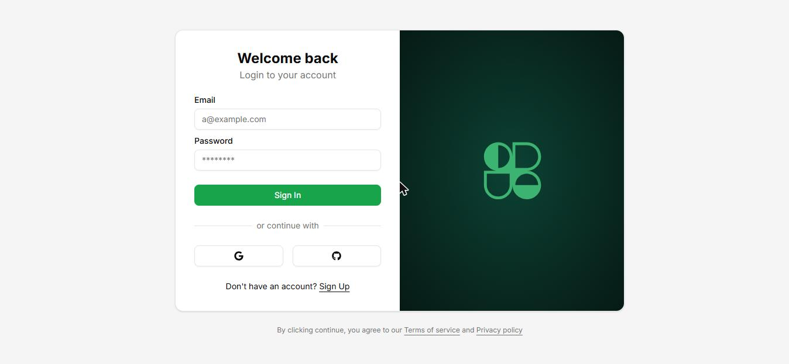
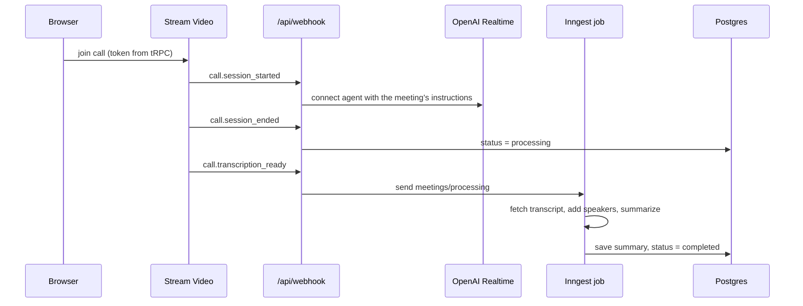

# Buddy AI

**Video meetings with an AI participant.** Create custom AI agents, start a call with one, and get a transcript and an AI-written summary when the meeting ends.

**Live demo:** https://buddy-ai-eight.vercel.app




## What it does

- **Custom AI agents.** Create an agent with a name and instructions that define how it behaves in a meeting.
- **Real-time calls.** Start a video call; the agent joins the call and talks with you using OpenAI's realtime API.
- **Meeting lifecycle.** Each meeting moves through `upcoming → active → processing → completed` (or `cancelled`).
- **Transcript and recording.** When the call ends, the transcript and recording are attached to the meeting.
- **AI summary.** A background job turns the transcript into a readable summary with sections and timestamp ranges.
- **Dashboard.** Searchable, filterable, paginated tables of agents and meetings.
- **Auth.** Email sign-in plus Google and GitHub, with better-auth.

## How it works



1. The client asks the server (tRPC) for a Stream Video token and joins the call.
2. When the call session starts, the Stream webhook handler looks up the meeting and its agent and connects an **OpenAI realtime client** that uses the agent's instructions.
3. When the transcript is ready, an **Inngest** function fetches it, resolves who spoke (users and agents), and runs a summarizer agent. The summary is stored on the meeting.

The webhook and background job are separate on purpose: the webhook responds fast, and the slower summarisation runs as a retryable job.

## Tech stack

| Area | Tools |
| --- | --- |
| Framework | Next.js (App Router), React, TypeScript |
| API | tRPC + TanStack Query, Zod |
| Database | PostgreSQL on Neon, Drizzle ORM |
| Auth | better-auth (email, Google, GitHub) |
| Video and realtime AI | Stream Video SDK, OpenAI realtime API |
| Background jobs | Inngest (with agent-kit for the summarizer) |
| UI | Tailwind CSS, Radix UI / shadcn-style components, TanStack Table, nuqs for URL state |

## Run it locally

```bash
git clone https://github.com/Rakesh-27-git/Buddy-AI.git
cd Buddy-AI
npm install
cp .env.example .env     # fill in the keys listed below
npm run db:push          # create tables with Drizzle
npm run dev
```

Run the Inngest dev server in another terminal (`npx inngest-cli@latest dev`). To receive Stream webhooks locally, expose port 3000 with ngrok and set that URL as the webhook in your Stream dashboard.

Environment variables: `DATABASE_URL`, `NEXT_PUBLIC_APP_URL`, `GOOGLE_CLIENT_ID`, `GOOGLE_CLIENT_SECRET`, `GITHUB_CLIENT_ID`, `GITHUB_CLIENT_SECRET`, `NEXT_PUBLIC_STREAM_VIDEO_API_KEY`, `STREAM_VIDEO_SECRET_KEY`, `OPENAI_API_KEY`.

## Things I'd improve next

- Tests for the webhook handler and the transcript-processing job.
- Showing the summary in the UI as soon as processing finishes.
- Rate limits on agent creation and calls.

## Author

Built by [Rakesh Choudhary](https://github.com/Rakesh-27-git).
